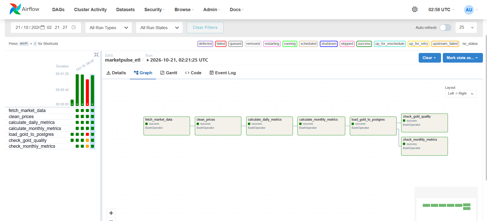
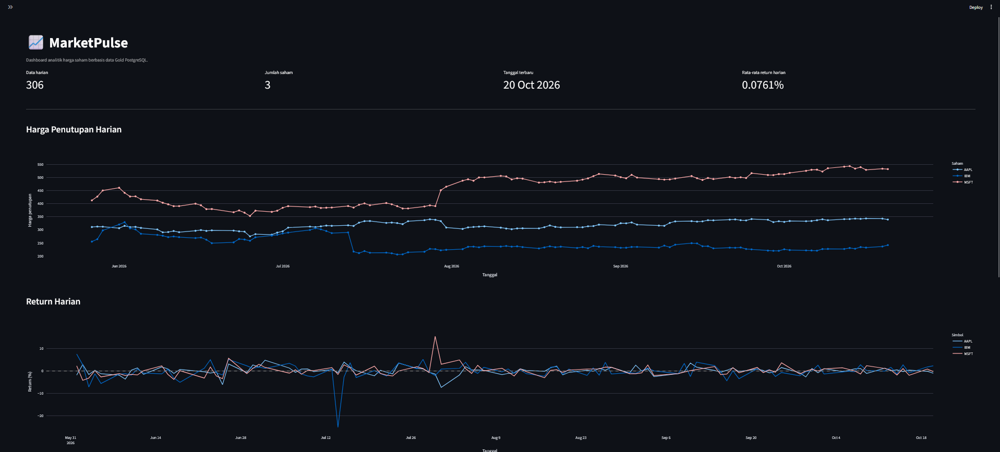
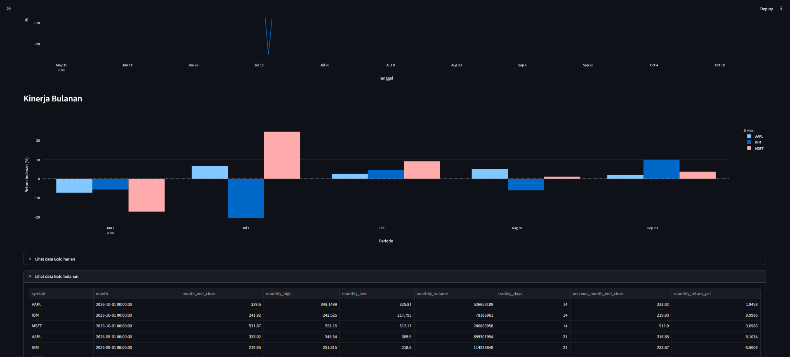

# MarketPulse — Pipeline Data Analitik Pasar Saham

MarketPulse adalah proyek portofolio Data Engineering yang membangun pipeline data dari pengambilan data pasar saham, pembersihan data, transformasi menjadi dataset analitik, pemuatan data ke PostgreSQL, hingga visualisasi melalui dashboard interaktif.

Proyek ini menerapkan proses *data ingestion*, *data cleaning*, transformasi analitik, orkestrasi pipeline, pemeriksaan kualitas data, penyimpanan dalam basis data relasional, dan pengembangan dashboard.

## 1. Gambaran Umum Proyek

MarketPulse memproses data pasar saham harian untuk tiga simbol:

- Apple (`AAPL`)
- IBM (`IBM`)
- Microsoft (`MSFT`)

Pipeline menghasilkan metrik analitik harian dan bulanan yang disimpan pada Gold Layer dan dapat dianalisis melalui PostgreSQL serta dashboard Streamlit.

## 2. Arsitektur Sistem

```text
       Stock Market API
              |
              v
          Raw Data
              |
              v
        Data Cleaning
              |
              v
         Silver Data
              |
       +------+------+
       |             |
       v             v
 Daily Metrics  Monthly Metrics
       |             |
       +------+------+
              |
              v
       Gold Data (Parquet)
              |
              v
          PostgreSQL
              |
              v
       Streamlit + Plotly
           Dashboard

Apache Airflow mengatur urutan eksekusi
pipeline dan menjalankan pemeriksaan
kualitas data.
```

## 3. Teknologi yang Digunakan

| Teknologi | Kegunaan |
|---|---|
| Python | Pengambilan dan transformasi data |
| Pandas | Pengolahan data dan perhitungan analitik |
| Apache Airflow | Orkestrasi pipeline dan pemantauan task |
| PostgreSQL | Penyimpanan data analitik Gold Layer |
| SQLAlchemy | Koneksi aplikasi ke basis data |
| Streamlit | Pengembangan dashboard interaktif |
| Plotly | Visualisasi grafik interaktif |
| Pytest | Pengujian otomatis |
| Docker Compose | Pengelolaan container |
| WSL Ubuntu | Lingkungan pengembangan |

## 4. Alur Data Pipeline

Pipeline dijalankan melalui DAG `marketpulse_etl` di Apache Airflow yang terdiri dari tujuh task:

1. `fetch_market_data` — mengambil data pasar saham dari penyedia API.
2. `clean_prices` — membersihkan dan memvalidasi data harga.
3. `calculate_daily_metrics` — menghitung metrik analitik harian.
4. `calculate_monthly_metrics` — mengagregasi data menjadi metrik bulanan.
5. `load_gold_to_postgres` — memuat dataset Gold ke PostgreSQL.
6. `check_gold_quality` — memeriksa kualitas data Gold harian.
7. `check_monthly_metrics` — memeriksa konsistensi metrik bulanan.

Apache Airflow mengatur dependensi antartask serta menyediakan informasi status dan log eksekusi untuk membantu pemantauan pipeline.

### Dokumentasi Eksekusi Airflow

Screenshot berikut menunjukkan dokumentasi visual pipeline MarketPulse di Apache Airflow.



## 5. Model Data Gold Layer

### 5.1. `gold_daily_metrics`

Tabel ini menyimpan data harga saham harian beserta metrik yang dihitung dari data tersebut.

Kolom utama:

- `symbol`
- `trade_date`
- `open_price`
- `high_price`
- `low_price`
- `close_price`
- `volume`
- `previous_close`
- `daily_return_pct`
- `daily_range`
- `intraday_return_pct`

Kunci utama tabel adalah kombinasi `(symbol, trade_date)`.

### 5.2. `gold_monthly_metrics`

Tabel ini menyimpan metrik kinerja saham bulanan.

Kolom utama:

- `symbol`
- `month`
- `month_end_close`
- `monthly_high`
- `monthly_low`
- `monthly_volume`
- `trading_days`
- `previous_month_end_close`
- `monthly_return_pct`

Kunci utama tabel adalah kombinasi `(symbol, month)`.

## 6. Dashboard MarketPulse

Dashboard dikembangkan menggunakan Streamlit dan Plotly untuk membantu pengguna mengeksplorasi data analitik yang tersimpan di PostgreSQL.

Fitur yang tersedia:

- Filter berdasarkan simbol saham.
- Filter berdasarkan rentang tanggal.
- Informasi jumlah baris data harian.
- Informasi jumlah saham yang dipilih.
- Informasi tanggal perdagangan terbaru.
- Rata-rata return harian.
- Grafik tren harga penutupan.
- Analisis return harian.
- Grafik kinerja bulanan.
- Tabel data Gold harian dan bulanan.
- Unduhan data analitik dalam format CSV.

### Tampilan Dashboard

**Tampilan pertama**



**Tampilan kedua**



Dashboard membaca data dari tabel Gold Layer di PostgreSQL sehingga metrik dan visualisasi dapat diperbarui ketika data sumber berubah dan cache aplikasi diperbarui.

## 7. Hasil Pengujian dan Validasi

Berdasarkan hasil pengujian selama pengembangan, proyek memperoleh hasil berikut.

| Pemeriksaan | Hasil |
|---|---:|
| Pengujian otomatis | 7 berhasil |
| Pemeriksaan kompilasi Python | Berhasil |
| Jumlah record Gold harian | 300 |
| Jumlah record Gold bulanan | 18 |
| Kunci Gold harian yang kosong | 0 |
| Kunci Gold harian duplikat | 0 |
| Kunci Gold bulanan yang kosong | 0 |
| Kunci Gold bulanan duplikat | 0 |

Seluruh tujuh task pada eksekusi Airflow yang diamati berhasil diselesaikan, termasuk pemuatan data ke PostgreSQL dan pemeriksaan kualitas data harian serta bulanan.

Angka tersebut menggambarkan dataset dan hasil eksekusi yang diamati selama pengembangan. Hasil dapat berubah apabila data baru dimasukkan ke dalam pipeline.

## 8. Prasyarat

Sebelum menjalankan proyek, siapkan:

- Docker Desktop dengan integrasi WSL.
- WSL Ubuntu.
- Python dan virtual environment.
- Git.
- API key dari penyedia data pasar saham yang digunakan.

## 9. Konfigurasi Environment

Buat file `.env` pada direktori utama proyek. Gunakan struktur berikut dan isi kredensial dengan milik sendiri.

```dotenv
ALPHA_VANTAGE_API_KEY=your_api_key
POSTGRES_DB=marketpulse
POSTGRES_USER=revana
POSTGRES_PASSWORD=your_secure_password
POSTGRES_HOST=127.0.0.1
POSTGRES_PORT=5432
AIRFLOW_UID=1001
```

**Penting:** jangan mengunggah file `.env`, API key asli, atau kata sandi basis data ke GitHub.

Konfigurasi host PostgreSQL berbeda sesuai lingkungan eksekusi:

- Python lokal dan Streamlit menggunakan `127.0.0.1`.
- Airflow di dalam Docker menggunakan nama service PostgreSQL, yaitu `postgres`.

## 10. Instalasi dan Menjalankan Proyek

### 10.1. Clone repository

```bash
git clone https://github.com/revansanreigoputra/marketpulse.git
cd marketpulse
```

### 10.2. Membuat dan mengaktifkan virtual environment

```bash
python3 -m venv .venv
source .venv/bin/activate
```

### 10.3. Menginstal dependensi Python

```bash
pip install -r requirements.txt
```

### 10.4. Mengatur environment

Buat file `.env` di direktori utama proyek berdasarkan konfigurasi pada bagian sebelumnya.

### 10.5. Menjalankan layanan Docker

```bash
docker compose up -d --build
```

Periksa status container:

```bash
docker compose ps
```

Pastikan layanan PostgreSQL dan Airflow berjalan dengan baik.

### 10.6. Menjalankan pipeline Airflow

Buka alamat berikut:

`http://localhost:8080`

Cari DAG `marketpulse_etl`, kemudian jalankan pipeline. Gunakan tampilan Graph dan log task untuk memantau proses serta memeriksa hasil eksekusi.

### 10.7. Menjalankan dashboard

Pastikan PostgreSQL aktif dan tabel Gold sudah terisi. Dengan virtual environment yang aktif, jalankan:

```bash
streamlit run src/marketpulse/dashboard/app.py
```

Buka dashboard melalui:

`http://localhost:8501`

### 10.8. Menjalankan pengujian otomatis

```bash
PYTHONPATH=src pytest -q
```

Hasil yang diharapkan berdasarkan pengujian saat ini:

```text
7 passed
```

Periksa sintaks Python:

```bash
python -m compileall -q src tests airflow/dags
```

## 11. Struktur Proyek

Gambaran umum struktur direktori:

```text
marketpulse/
├── airflow/
│   ├── dags/
│   ├── logs/
│   ├── plugins/
│   └── config/
├── data/
│   ├── raw/
│   ├── silver/
│   └── gold/
├── docs/
│   └── images/
│       ├── marketpulse_etl.png
│       ├── marketpulse-dashboard1.png
│       └── marketpulse-dashboard2.png
├── src/
│   └── marketpulse/
│       ├── dashboard/
│       ├── ingestion/
│       ├── transformations/
│       ├── aggregations/
│       ├── quality/
│       └── storage/
├── tests/
├── compose.yaml
├── requirements.txt
├── .env
└── README.md
```

Struktur di atas merupakan gambaran umum. Direktori seperti data, log, dan file konfigurasi lokal tidak semuanya harus dilacak atau diunggah ke Git.

## 12. Pengembangan Selanjutnya

Beberapa pengembangan yang dapat dilakukan:

- Menambahkan penjadwalan otomatis dan mekanisme pemulihan ketika pipeline gagal.
- Meningkatkan logging dan notifikasi kegagalan.
- Menambahkan aturan pemeriksaan kualitas data.
- Menambah simbol saham dan rentang data historis.
- Meningkatkan performa dan fitur analitik dashboard.
- Mengintegrasikan CI untuk pengujian otomatis dan pemeriksaan kualitas kode.

## 13. Hasil Pembelajaran

Melalui proyek MarketPulse, saya mempraktikkan pembangunan pipeline data dari proses ingestion hingga analitik, orkestrasi task menggunakan Apache Airflow, penyusunan dataset analitik harian dan bulanan, pemuatan data ke PostgreSQL, validasi kualitas data, serta penyajian hasil melalui dashboard interaktif.

Proyek ini menjadi bagian dari portofolio pembelajaran Data Engineering yang menunjukkan penerapan proses pengolahan data secara terstruktur dari sumber hingga visualisasi.
